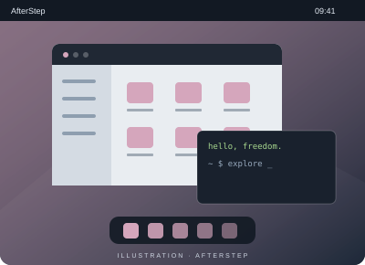

# AfterStep

**Le goût des origines.**

Un gestionnaire de fenêtres pour explorer une autre façon d’organiser son écran et découvrir la diversité des interfaces Linux.

- Un univers visuel inspiré de NeXTSTEP
- Une organisation modulaire du bureau
- Un terrain de découverte pour les curieux

[Site du projet](http://www.afterstep.org/) · [Découvrir aussi Window Maker](windowmaker.md)
