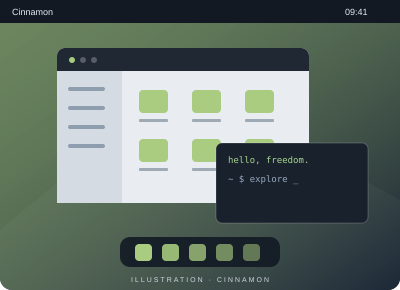

# Cinnamon

**Un bureau familier.**

Développé par le projet Linux Mint, Cinnamon propose une interface de bureau avec menu, panneau et fenêtres.

- Un menu d’applications et un panneau
- Des réglages regroupés dans une interface graphique
- Des applets pour personnaliser le bureau

[Site du projet](https://github.com/linuxmint/cinnamon) · [Découvrir MATE](mate.md)
