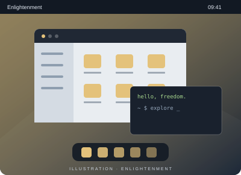

# Enlightenment

**Un autre regard.**

Enlightenment associe un gestionnaire de fenêtres, un compositeur et un bureau minimal avec une identité visuelle singulière.

- Une interface personnalisable
- Les bibliothèques EFL au cœur du projet
- Un bureau qui explore les effets visuels

[Site du projet](https://www.enlightenment.org/) · [Explorer les bureaux singuliers](afterstep.md)
