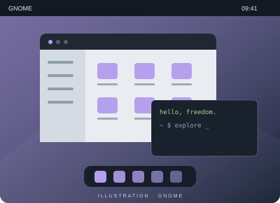

# GNOME

**Faire place à l’essentiel.**

La vue Activités rassemble les fenêtres, les applications et les espaces de travail dans une interface cohérente.

- Une vue d’ensemble des activités
- Des espaces de travail pour organiser ses tâches
- Une navigation pensée aussi pour le clavier

[Site du projet](https://www.gnome.org/) · [Retrouver KDE Plasma](kde.md)
