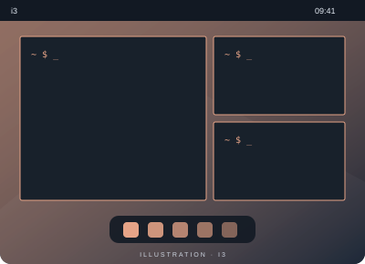

# i3

**Chaque fenêtre à sa place.**

i3 est un gestionnaire de fenêtres en mosaïque. Les fenêtres s’organisent dans une structure arborescente, pilotable au clavier.

- Une disposition en mosaïque
- Des espaces de travail et des raccourcis
- Un fichier de configuration lisible

[Site du projet](https://i3wm.org/) · [Recommencer l’exploration](kde.md)
