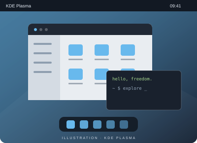

# KDE Plasma

**La liberté du détail.**

Un bureau qui se façonne autour de vos habitudes. Plasma propose des panneaux, des composants graphiques et de nombreux réglages.

- Des panneaux et des widgets personnalisables
- Un lanceur pour retrouver applications et documents
- Un écosystème riche d’applications KDE

[Site du projet](https://kde.org/plasma-desktop/) · [Comparer avec Xfce](xfce.md)
