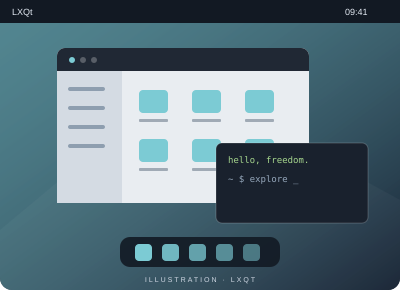

# LXQt

**Le bureau à l’essentiel.**

LXQt est un environnement de bureau léger et modulaire construit avec Qt.

- Une organisation en composants
- Un panneau et un menu d’applications
- Une interface fondée sur Qt

[Site du projet](https://lxqt-project.org/) · [Comparer avec Xfce](xfce.md)
