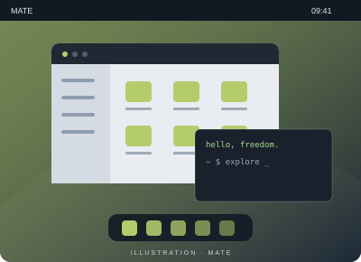

# MATE

**La continuité, simplement.**

MATE prolonge l’expérience de GNOME 2 et conserve les repères d’un bureau traditionnel.

- Des menus et des panneaux familiers
- Une organisation classique des fenêtres
- Un environnement pour Linux et les systèmes Unix

[Site du projet](https://mate-desktop.org/) · [Comparer avec GNOME](gnome.md)
