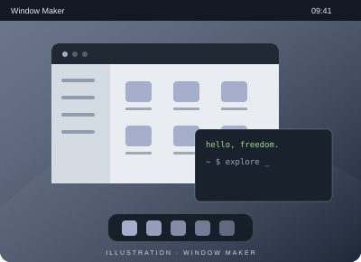

# Window Maker

**Des fenêtres, du caractère.**

Window Maker est un gestionnaire de fenêtres X11 dont l’interface s’inspire de NeXTSTEP.

- Un dock et de petites applications dockables
- Des raccourcis clavier configurables
- Des menus et une présentation personnalisables

[Site du projet](https://www.windowmaker.org/) · [Revenir à AfterStep](afterstep.md)
