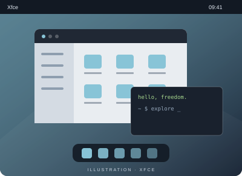

# Xfce

**Léger dans ses gestes.**

Xfce privilégie la modularité et une consommation de ressources mesurée, avec une organisation de bureau traditionnelle.

- Des composants utilisables séparément
- Des panneaux et des espaces de travail
- Thunar pour parcourir ses fichiers

[Site du projet](https://xfce.org/about) · [Explorer un autre bureau léger](lxqt.md)
